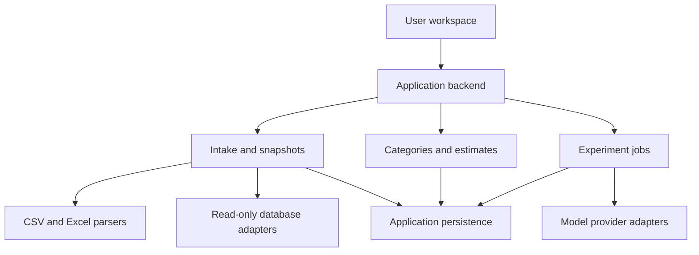

# Review Classification Workbench — Architecture

Version: 0.6  
Date: 18 September 2026  
Status: Initial architecture; implementation plan intentionally deferred.  
Working title only; final product name is undecided.

## 1. Purpose and document authority

The product helps users see the difference between their expected classifications and actual AI classifications before processing a large review dataset. It combines data intake, common-baseline `tiktoken` accounting, model-specific pricing, category definition or discovery, and actual sample execution in one workspace.

Users arrive with existing information: uploaded CSV/Excel files or a live company database. Building a web scraper is not part of this architecture. The origin of the data does not change the classification workflow.

This document captures confirmed product requirements and establishes explicit architecture constraints. Architecture constraints below are prescribed design decisions for this document, not claims that the user previously selected a technology stack. Unresolved technology and release decisions are listed in section 15. Windsurf must not silently resolve those decisions or expand scope.

This document is not an instruction to start coding. The implementation plan will be created separately. No task sequence, sprint plan, package installation instructions, or deployment procedure is included here.

## 2. Confirmed product requirements

| ID | Requirement |
| --- | --- |
| R01 | Users can upload CSV and Excel files. |
| R02 | Users can connect to a live database using read-only access and choose a table or view. |
| R03 | Both entry points converge on a common data preview and column-mapping experience. |
| R04 | Users choose the review text and optional ID, date, rating, language, product and source fields. |
| R05 | Users inspect rows, identify data issues, filter scope and see the selected record count. |
| R06 | Users see `tiktoken`-based review token counts and cost estimates across supported models for their intended volume. |
| R07 | Users can provide existing categories or start without categories. |
| R08 | Users execute actual model calls on a small subset and inspect source text beside classifications. |
| R09 | Users refine category definitions, instructions and output rules, and compare revisions. |
| R10 | Database connection or upload alone never starts AI processing. |
| R11 | Experiments use fixed dataset snapshots and saved samples so revisions remain comparable. |
| R12 | After data preview, users define the intended workload as all eligible reviews, 25%, 50%, 75%, a custom number, or explicitly selected rows. |
| R13 | Pre-run estimates use `tiktoken` as the sole token-counting engine; provider-reported usage recalibrates projections after a paid preview run. |
| R14 | Before spending on classification, users can narrow the preview candidate pool, choose a sampling strategy, inspect the selected reviews and replace unsuitable selections. |
| R15 | Users can record expected outcomes for preview rows and compare those expectations with actual model results. |
| R16 | Configuration revisions reuse the same saved sample by default; a fresh sample is available for subsequent validation. |
| R17 | Classification Preview executes only with one application-selected low-cost OpenAI model; the preview UI does not expose a model selector. |
| R18 | Cost Estimator may compare supported OpenAI, Anthropic and Gemini pricing, while clearly separating estimates from tested preview behaviour. |
| R19 | After expectation/result comparison, the application derives measured signals and may use the same preview model to generate evidence-linked configuration recommendations. |
| R20 | Recommendations never modify an accepted taxonomy or configuration automatically; applying one creates a reviewable draft version. |
| R21 | After accepting a configuration, users can export it, execute the complete intended workload, or do both. |
| R22 | Every successful classification contains category, supporting evidence and classification state. |
| R23 | Undefined discovery proposes at most seven defined categories with evidence and explicit tentative/overlap handling before fresh-sample validation. |
| R24 | Diverse text sampling uses local TF-IDF and cosine distance in the first version and incurs no provider call. |
| R25 | Public visitors receive one application-funded five-review preview; additional preview/recommendation calls require a session-only user OpenAI key. |
| R26 | Anonymous data expires after 24 hours; signed-in project data expires seven days after last activity unless deleted earlier. |
| R27 | Users can export configuration JSON, classification CSV/Excel, cost estimates and a Markdown project summary separately or as a project package. |

The central user decision is: “Will this setup produce the classifications I need, and what will it cost at my intended volume?”

## 3. Scope boundaries

Included: data intake, inspection, explicit selection, immutable experiment inputs, token and cost analysis, category configuration, sample execution, human review and revision comparison.

Not included in this version of the architecture: scraping websites; training or fine-tuning model weights; autonomous changes to category definitions; writing classifications back into source databases; automatic continuous classification; billing users; synthetic demo results.

After accepting a configuration, the product supports both exporting that configuration and executing the complete intended workload. Full execution operates on the frozen workload/snapshot and accepted configuration. Source-database write-back remains outside scope; results are exported for downstream use.

## 4. Logical architecture

Use a modular application with a separate background execution boundary for long-running operations. These are logical modules, not a requirement to deploy microservices.

| Component | Owns | Must not do |
| --- | --- | --- |
| User workspace | Connection forms, previews, field mapping, filters, estimates, experiment controls and comparisons | Hold persistent provider/database secrets or invent results locally |
| Application backend | Validation, access checks, scope definitions, version creation and job requests | Make provider calls merely because a page was opened |
| File intake | File validation, sheet selection, parsing, source-row identity and import diagnostics | Execute workbook macros or silently remove records |
| Database adapters | Connection validation, metadata discovery and bounded reads from approved tables/views | Modify source data or execute arbitrary user SQL in this initial design |
| Snapshot module | Persist selected source records, mapping, provenance and content hashes | Mutate data already referenced by an experiment |
| Preview selection module | Eligibility screening, candidate filters, reproducible sampling and sample manifests | Classify records or imply that a deliberately selected sample represents the dataset |
| Token/cost module | Token-count methods, request overhead, price versions and estimates | Treat an unknown price or unknown token count as zero |
| Category/configuration module | Versioned category definitions, prompts and output rules | Overwrite a configuration already used by a run |
| Experiment executor | Saved sample execution, response validation, progress and usage accounting | Replace failed calls with fabricated classifications |
| Recommendation module | Deterministic preview diagnostics, evidence packaging, recommendation calls and draft suggestions | Present unsupported advice as measured fact or modify accepted configuration automatically |
| Full-job executor | Accepted-configuration validation, complete workload dispatch, checkpoints, usage/spend tracking and result assembly | Run from an unaccepted draft or write results into the source database |
| Export module | Versioned configuration, result, estimate, summary and package generation | Include credentials, API keys or fields the user excluded |
| Identity and quota module | Anonymous/signed-in ownership, free-preview allowance, user-key sessions, rate/spend limits and retention enforcement | Trust browser-only limits or mix data between users/sessions |
| Provider adapters | Provider-specific request construction, model identity and usage normalization | Expose provider differences as falsely equivalent measurements |
| Application persistence | Source metadata, snapshots, versions, runs, outputs and human review | Store secrets in ordinary metadata or raw logs |

Metadata and dataset payloads are separate logical storage concerns. Exact database, file/object storage, job mechanism and hosting choices remain open.

## 5. Data connection workspace

### 5.1 File path

1. User selects CSV or Excel. Target formats are CSV, XLSX and XLS; unsupported formats must be rejected visibly if not implemented in the eventual release.
2. System validates file format and reports parsing errors. Excel users select one sheet per import; do not automatically combine sheets.
3. Show headers and a bounded preview, plus detected delimiter/encoding for CSV. Ambiguous parsing requires user correction; never silently load all text into one column.
4. User confirms the header row and maps fields. Preserve original values and physical source-row references.
5. Show import diagnostics and scope controls before snapshot creation.

Spreadsheet formulas must never be executed by the application. Missing cached formula values must be reported. Duplicate headers need unique internal column identities while preserving their original displayed labels.

### 5.2 Database path

1. User chooses a supported database adapter and supplies connection details through the backend.
2. “Test connection” reports connection status without reading an entire table.
3. User chooses an accessible schema and table/view, selects columns, and configures typed filters.
4. Show a bounded preview and scoped row count with its exact/estimated/unknown status and observation time.
5. User requests a snapshot. The backend reads only the selected columns and rows, subject to declared limits.

Use read-only credentials and read-only transactions where supported. Table and column identifiers must come from discovered metadata; filter values must be parameterized. Do not assume SQL string inspection alone creates a secure read-only connection.

Use timeouts, bounded pagination and cancellation. Connector-specific pagination must avoid silent omissions or duplicates. Prefer a consistent database snapshot where supported. Where unavailable, record extraction start/end times and disclose that the source may have changed during extraction.

“Live database” means a current source connection with explicit refresh. It does not mean background streaming or continuous AI calls. Refresh creates a new dataset version and preserves prior experiments. No silent reuse of stale connection metadata after a schema change.

### 5.3 Shared preview and scope

Required mapping: one review text field. Optional mapping: source record ID, timestamp, rating, language, product and source. Do not guess and commit mappings without user confirmation. A missing source ID is allowed: generate an internal ID and preserve file row or database extraction provenance.

Display loaded count, selected count, eligible count and excluded count separately. A preview page size is not the dataset total. If a count has not completed, show “Counting” or “Unknown,” never a made-up total.

Blank/null review text is ineligible for model execution and remains visible in diagnostics. Non-text values require an explicit conversion rule or exclusion. Duplicate text is flagged and retained by default; repeated feedback may be legitimate. No automatic deduplication, translation, summarization, truncation or sentiment enrichment.

Filters act on mapped fields. Preview the effect before saving the selection. Users must see the exclusion reason for each excluded record. Original source data remains unchanged.

### 5.4 Transition to Project Requirements

Completing Data Preview moves the user to the Project Requirements tab. Preview completion means that a dataset snapshot exists, the review field is confirmed, eligibility diagnostics are available and the user can see the captured population. It does not mean that the production workload or classification sample has been selected.

Project Requirements defines the intended production workload using exactly one of these modes:

| Mode | Required behaviour |
| --- | --- |
| All eligible reviews | Include every eligible record in the current snapshot. |
| 25%, 50% or 75% | Resolve the proportion into a reproducible random selection of actual record IDs. Display the resulting integer count and rounding rule before saving. |
| Custom number | Accept an integer between 1 and the eligible-record count, then create a reproducible random selection of that size. |
| Specific rows | Allow explicit row selection across table pages and filters. Store the selected record IDs, not page positions. |

Percentage and custom-count modes use a saved random seed and an ordered list of record IDs. Changing the selection mode, count, seed, snapshot or eligibility rules creates a new workload version. The user can inspect the resolved rows before continuing.

The selected percentage refers to records, not tokens. Review lengths vary, so the system calculates tokens from the actual selected records after resolving the workload. Display the captured population, eligible population, intended workload count and workload review-text tokens separately.

The intended workload is distinct from the paid classification-preview sample. A user may plan to process 10,000 reviews while previewing only 5–10 of them. The product must show the cost of the preview and the projected cost of the intended workload as separate quantities.

## 6. Snapshot and data contracts

| Entity | Minimum content |
| --- | --- |
| Source | ID, type, display name, format/adapter, file or connection reference, creation time; no plaintext secrets |
| DatasetSnapshot | ID, source ID, extraction times, mapping, selection/filter specification, exact captured count, eligibility counts, content hash and consistency mode |
| ReviewRecord | Internal ID, snapshot ID, original source ID if available, original review text, mapped metadata, source-row locator, content hash and eligibility reason |
| WorkloadVersion | ID, snapshot ID, selection mode, requested percentage/count, rounding rule, seed where applicable, ordered record IDs, resolved count and review-text token total |
| Sample | ID, snapshot/workload IDs, eligibility-rules version, filter specification, ordered record IDs, selection method, seed or diversity-method version where applicable, selection time and stated sampling limitations |
| ExpectedOutcome | Sample and record IDs, configuration/category-set version if defined, expected primary/secondary labels, expected unmatched/ambiguous state, optional note and author/time |
| CategorySetVersion | ID, parent version, stable category IDs, names, definitions, optional inclusion/exclusion examples and user acceptance state |
| ExperimentConfigVersion | ID, category version, task instructions, single/multiple-label policy, output schema, prompt-template version, selected input fields and model settings |
| PreviewModelVersion | Exact OpenAI model ID, display label, enabled-from/to dates, execution settings and application limit policy version |
| PriceVersion | Provider/model ID, source reference, retrieval/effective date, currency, rates, billing-unit definitions and supported discounts |
| CostEstimate | Snapshot/workload/sample/config references, `tiktoken` encoding and version, rendered-request counts, component tokens, output assumptions, model, price version, estimate range and exclusions |
| ExperimentRun | ID, sample/config/model references, request manifest, status, timestamps, usage totals, cost basis and retry/cancellation history |
| ClassificationResult | Run and record IDs, processing status, assigned category IDs, supporting source spans, validation errors and response reference |
| DiagnosticSignal | Run/configuration IDs, deterministic rule ID/version, measured value, denominator, affected record/category IDs and supporting evidence references |
| Recommendation | Run ID, diagnostic-signal IDs, exact recommendation model ID, recommendation type, explanation, evidence references, suggested patch, status and creation time |
| HumanReview | Run/record reference, accepted/corrected/flagged state, corrected labels, optional note and reviewer/time |
| FullJob | ID, owner, frozen snapshot/workload/accepted-configuration references, preview model version, price version, funding source, status, checkpoints, usage/spend totals and timestamps |
| ExportManifest | Schema version, project/configuration/run IDs, requested files/fields, generation time, checksums and retention reference |

Records, category versions, configurations and runs require stable IDs. Human corrections are stored separately from model output. They do not retrospectively change a completed run or automatically become prompt examples.

## 7. Token accounting and cost architecture

### 7.1 One pre-run counting engine

Use `tiktoken` as the sole pre-run token-counting engine for all supported models and providers. Do not call Anthropic, Gemini or another provider merely to count the uploaded dataset. Store the exact `tiktoken` encoding and library version with every estimate.

All pre-run displays must say **tiktoken estimate**. OpenAI models may align closely with this count when the mapped encoding is correct. Anthropic, Gemini and other providers use different tokenization, so their pre-run quantities are common-baseline estimates rather than provider-exact billing counts. Do not describe them as exact provider tokens.

After an executed preview, preserve the original `tiktoken` estimate and capture provider-reported usage separately. Actual provider usage becomes the basis for a recalibrated projection for that exact provider, model, request configuration and output schema.

### 7.2 Token quantities

Keep these quantities separate:

- **Review-content tokens:** `tiktoken` count of the exact review text in the intended workload.
- **Fixed prompt tokens:** instructions, taxonomy definitions, few-shot examples and output-schema instructions repeated in each request.
- **Row-wrapper tokens:** record IDs, selected metadata, delimiters and serialization around reviews.
- **Estimated request-input tokens:** token count of every fully rendered request before execution.
- **Estimated output tokens:** a range derived from the chosen output contract before execution.
- **Billable usage:** actual provider-reported input, cached input, output, reasoning/thinking and other supported usage after execution.

Counting only `number of reviews × average review tokens` is prohibited as the final cost estimate. Build the same request payloads that the executor would send, excluding secrets, and tokenize those rendered payloads. This captures repeated prompts and serialization overhead.

### 7.3 Request construction and batching

Let `N` be the intended-workload review count, `B` the configured reviews per request, `R = ceil(N / B)` the request count, `F` the fixed prompt tokens per request, `D` the sum of review-content tokens and `W` the total row-wrapper tokens across rendered requests.

`estimated input tokens = D + (F × R) + W`

Calculate the final partial request using its actual number of reviews. Do not multiply an average full request by `R` when the last request is smaller.

Classification Setup must capture every setting that changes the request: classification instructions, existing or proposed taxonomy, category definitions, single-label or multi-label policy, few-shot examples, selected metadata, output fields, evidence/explanation requirements and reviews per request.

Initial preview execution may be limited to 5–10 reviews to control product spend, but the estimator supports the intended workload independently. The exact preview limit and who supplies provider credentials remain implementation-plan decisions.

### 7.4 Output estimate

Output cannot be counted exactly before execution. Generate a representative valid output object from the selected schema, tokenize it with `tiktoken`, and establish a documented low/base/high per-review range. Multiply the range by the workload size while accounting for any request-level wrapper.

Output scope may include category only; category plus sentiment; multi-label category, subcategory and evidence; or a detailed object containing evidence and explanation. Do not use an unexplained universal number of output tokens per review. Category values and evidence spans affect the estimate.

Model-generated confidence is an optional output field, not a measured probability of correctness. Hidden chain-of-thought must not be requested or exposed as a cost-estimation mechanism. If a provider bills reasoning/thinking usage, represent it as a separate provider-specific estimated or observed component.

### 7.5 Versioned pricing catalogue

Maintain a versioned pricing record for every supported provider/model combination. Each record contains provider, exact model ID, currency, standard input rate, cached-input rate where applicable, output rate, batch/processing tier, context-dependent price thresholds, supported additional billable token types, official source reference and effective/retrieval date.

Pricing is deterministic catalogue data; an AI model must never generate or infer it. A model without a valid price record can display token estimates but must show monetary cost as unavailable. Historical estimates and runs retain the price version used at creation.

Do not automatically apply cached-input or asynchronous-batch discounts. Apply them only when the selected request design and processing mode qualify. If the catalogue cannot represent a provider's pricing rule, identify the omitted component and mark the total incomplete.

For model `m`:

`estimated cost(m) = (uncached input / 1M × input rate[m]) + (cached input / 1M × cached rate[m]) + (output / 1M × output rate[m]) + additional provider-specific cost[m]`

### 7.6 Explainable comparison

For every model, show the same workload and request configuration with a breakdown for review content, instructions, taxonomy, examples, schema/wrappers, expected output and any provider-specific component. Each row shows tokens, applied rate and estimated cost. Also show the price version/date and processing mode.

Provide cost attribution by component so users can see why the estimate changed. Component percentages use the component's estimated monetary cost as the numerator and total estimated cost as the denominator. Do not present token share as cost share when input and output rates differ.

Editing the workload, categories, examples, selected fields, output rules, model, batch size or processing tier invalidates the current estimate for the new configuration and triggers recalculation. Preserve the earlier estimate with the earlier configuration.

### 7.7 Preview recalibration

After the 5–10 review classification preview, capture provider-reported input, cached-input, output, reasoning/thinking and total usage fields when available, plus actual cost calculated using the saved price version. Missing provider usage remains unknown and must not be stored as zero.

Compare the `tiktoken` estimate with provider-reported actual usage for the executed requests. Show absolute and percentage differences. Recalculate the intended-workload projection using observed per-request fixed overhead and observed per-review output, adjusted for the intended workload's actual review-content tokens and configured batch size. Label the result **preview-calibrated projection**.

Recalibration applies only to the application-selected OpenAI preview model and the exact configuration tested. Changing taxonomy, prompt, schema, batch size or processing mode requires a new preview for a new calibrated projection. Cost estimates for other models do not inherit this calibration and must not be presented as output-quality tests. Five to ten reviews provide a practical estimate but do not guarantee the output distribution of the full dataset; retain a low/base/high range.

Show the initial `tiktoken` estimate, estimated preview cost, actual preview spend, cumulative experiment spend and preview-calibrated intended-workload projection separately. Record retry spend separately, including failed calls that report usage.

For hypothetical volumes above captured data, clearly label the estimate as a projection. Any future monthly estimate for live sources requires an explicit incoming-volume assumption.

## 8. Category configuration paths

### Existing categories

User supplies category names and definitions, then selects single-label or multiple-label classification. The configuration must distinguish a successful “no category applies” outcome from ambiguity, insufficient context and a technical error. Do not force every review into a category.

Every successful defined-classification result contains: primary category (and secondary categories when multi-label is enabled), an exact supporting evidence span from the review, and one classification state from the configured state contract. Sentiment and subcategory are optional configuration fields. Model-reported confidence and explanations are optional and must retain the limitations and cost treatment defined elsewhere in this architecture.

Reject duplicate category IDs and flag duplicate names. Category changes create new versions. Renaming retains the category ID; merging/splitting creates explicit mappings so comparisons do not silently equate different category structures.

### No existing categories

User states the classification objective and selects a discovery sample. The preview model proposes at most seven categories. Each proposal contains a name, definition, supporting review IDs, exact supporting quotations and potential overlap with other proposed categories. No subcategories are proposed during initial discovery.

A proposed category supported by only one discovery review is labelled **Tentative**. A review may support multiple proposed categories. Reviews that do not support a coherent category remain **Unclassified**; the model must not force complete coverage. Proposals are visibly provisional. User can rename, merge, split, remove, add or edit categories before explicitly accepting a category-set version.

Discovery and classification are separate operations with separate usage records. Discovering a category structure does not count as successful classification evaluation. After acceptance, the tool enters Defined Classification and tests the taxonomy on a fresh 5–10 review validation sample. Results on the discovery sample alone must be identified as such.

Neither path autonomously changes the accepted taxonomy while running. Unsupported or emerging themes appear as unmatched/flagged results for user inspection.

## 9. Sampling and experiment execution

### 9.1 Preview purpose and separation

Classification Preview answers: “Before I classify thousands of records, what will the AI actually do with my data?” It operates on a saved 5–10 review sample while retaining the independently defined intended workload. Preview selection must reduce avoidable paid calls without claiming that the selected rows guarantee useful classifications or represent the full dataset.

The preview sequence is: establish eligibility, filter the candidate pool, choose a selection method, inspect the resolved rows, record expectations, execute the model call, compare expectations with results, revise configuration and rerun.

### 9.2 Preview eligibility screening

Before sample selection, derive a preview-eligible candidate pool using explicit, versioned rules. At minimum, detect blank/null text, whitespace or punctuation-only text, exact duplicates, language compatibility and configurable minimum text length. Short records such as “Good” may be low-information rather than invalid; exclude them from the preview pool only through a visible rule while retaining them in the dataset and intended workload unless the user separately changes workload eligibility.

Duplicate handling must be explicit. Flag exact duplicates and omit duplicate copies from the preview candidate pool by default so scarce preview slots are not wasted, while preserving their original frequency in workload counts. Near-duplicate detection is optional until an approved method exists.

Show the funnel as separate counts: captured records, workload records, preview-eligible records, records matching active filters and final selected sample. Every excluded preview record has a visible reason. Eligibility screening does not call a classification model.

### 9.3 Candidate-pool filters

Users can narrow preview candidates using mapped metadata and deterministic text conditions. Supported filter concepts include rating, product, date range, source, language, review length, keyword inclusion/exclusion and other imported fields with compatible types.

Filters operate on the saved snapshot and intended workload. Store the complete filter specification with the sample. Preview the resulting candidate count before selection. Keyword matching is a text filter, not a semantic classification, and the interface must describe it accordingly.

No filter may silently change the intended production workload. A user who wants the same filter applied to production must edit Project Requirements explicitly, which creates a new workload version and recalculates cost.

### 9.4 Selection methods

Support four preview-selection methods:

| Method | Required behaviour |
| --- | --- |
| Random | Reproducibly select 5–10 rows from the filtered candidate pool using a saved seed. |
| Diverse | Use local TF-IDF and cosine distance to select reviews that use different language and appear to cover different subjects; save the method version, seed and record IDs. |
| Manual | Let the user select exact rows across pages and filters. |
| Mixed | Combine explicitly selected rows with random or diverse rows until the requested sample size is reached. |

Diverse selection in the first version uses a local TF-IDF representation and cosine distance. After filters and eligibility rules, choose one reproducible starting review from the saved seed, then repeatedly select the candidate with the greatest minimum cosine distance from the already selected reviews until the sample is complete. Save the TF-IDF configuration, method version, seed, record IDs and ordering.

This operation makes no provider or embedding API call and keeps sampling text within the application. Process languages separately when reliable language metadata/detection is available. If the candidate pool is too small, text is too short, or the TF-IDF representation cannot produce a useful selection, explain the limitation and offer Random or Manual selection. Do not silently substitute another method. The user-facing label is **Diverse text sample**; technical TF-IDF terminology belongs in explanatory help rather than the primary workflow.

Diversity does not establish dataset representativeness. A filtered, diverse or manually chosen sample is diagnostic. Any distribution derived from it must be labelled as the preview sample distribution.

### 9.5 Inspection and reselection

Before execution, show all selected reviews with relevant metadata and selection reason. Users can remove a row, replace it from the candidate pool, regenerate random/diverse selections or switch methods. Regeneration produces a new sample identity and never changes a previously executed sample.

Store selected internal record IDs and ordering. Page number, current sort position and displayed row number are not stable identities. Reusing a sample must reconstruct the same records even when the source database has since changed.

### 9.6 Expectation capture

Expectation capture occurs before the model result is visible and remains optional per row. Encourage, but do not require, expectations for at least three preview reviews. The interface must distinguish “no expectation recorded” from “expected no category to apply.” Users may execute with zero expectations. Editing an expectation after execution creates a visible new expectation revision and must not overwrite the pre-run value.

For defined classification, a user can record an expected primary category, optional secondary categories, expected unmatched or ambiguous state and an optional note. Expected labels reference stable category IDs from the configuration version.

For undefined classification, the user has no accepted taxonomy. Capture a free-text expected theme or desired interpretation, expected multiple themes, expected no useful classification and an optional note. Do not fabricate category IDs from this free text.

### 9.7 Preview-model policy and disclosure

Classification Preview and category discovery execute only with one low-cost OpenAI model selected by the application. There is no model selector in the preview workflow while only one execution model is supported. Store the exact model ID, not only a marketing-family name, with every discovery call, classification run and recommendation call.

The Cost Estimator remains a separate capability and may compare pricing for supported OpenAI, Anthropic and Gemini models using the common `tiktoken` baseline and versioned price catalogue. A cost comparison is not evidence that those models were executed or that they will reproduce the preview model's classifications.

Use **Preview model** or **Low-cost preview model** in the interface, followed by the exact model name. Do not use “most basic model.” Display this persistent disclosure wherever multi-model estimates and preview results could be confused:

> **Cost estimates compare multiple models. Classification Preview currently runs using [exact model name] only.**

Before execution, show:

> This preview will classify [N] reviews using **[exact model name]**. Estimated preview cost: **[amount]**.

After execution, show:

> These results were generated using **[exact model name]** on **[execution date/time]** with configuration version **[version]**.

Explain that results show how this preview model interpreted the selected sample and do not predict another model's classifications. Undefined category discovery, defined category testing, expectation/result comparison and recommendation generation all use the same configured preview model.

The backend enforces the permitted 5–10 review count, per-run spending limit, cumulative spending limit and request/rate limits. UI controls alone are insufficient. Exact numeric cost/rate ceilings and the initial OpenAI model ID belong in the implementation plan and deployment configuration; changing the preview model creates a new `PreviewModelVersion` and never changes historical attribution.

### 9.8 Hybrid preview funding

Anonymous public visitors receive one application-funded classification preview of exactly five reviews. The allowance is enforced server-side against a signed anonymous session plus abuse controls such as IP-aware throttling; clearing browser state alone must not reliably reset it. The product must never promise a free run when the application-wide budget circuit breaker is closed.

Increasing a preview to 6–10 reviews, running another classification preview or generating recommendations requires a user-provided OpenAI API key for the active session. The backend restricts all calls to the configured `PreviewModelVersion`; a supplied key does not unlock model selection. Application-funded and user-funded usage are labelled and accounted separately.

The application-owned key exists only in backend deployment secrets. A user key is transmitted to the backend over HTTPS, held only in ephemeral server-side session memory, excluded from persistent storage, browser local storage, logs, traces, error payloads and exports, and removed when the session ends. The UI states which key will be charged before every paid action.

The backend enforces a global daily application-funded budget, per-session/project limits, concurrent-call limits and rate limits. When the free budget is unavailable, the estimator, local sampling and configuration workflow remain usable; the UI offers session-key execution without representing the free preview as completed.

### 9.9 Execution and reruns

The run request freezes snapshot, intended workload, preview sample, recorded expectations, category version where applicable, instructions, output schema, `PreviewModelVersion`, reviews-per-request and settings. Store an immutable request manifest. Preview requests use the same request-construction rules chosen for the intended workload so measured overhead can recalibrate that workload honestly.

Before a run, show sample size, selection method, exact preview model, category/configuration version, recorded-expectation count and estimated preview cost. Only an explicit run action dispatches model requests. Treat imported text as untrusted data, never as instructions to execute tools or change the classification task.

When instructions or taxonomy change, default to rerunning the same saved sample so expectation/result and version-to-version comparisons refer to identical records. After refinement, support a fresh validation sample from the candidate pool. Mark development-sample and fresh-validation-sample runs separately.

Validate responses against the output contract. Returned labels must exist in the selected category version for defined classification. Supporting text must match the original review; invalid evidence is flagged, not silently repaired. Handle context-limit failures visibly; never truncate text without an explicit user-selected policy.

Run states are queued, running, completed, completed_with_errors, cancelled and failed. Per-record processing states are pending, running, succeeded, failed and cancelled. A successful record additionally has a classification outcome such as classified, unmatched, ambiguous or insufficient_context.

Cancellation stops undispatched requests; in-flight calls may complete and incur usage. Preserve successful results after partial failure. Retry failed records only under a bounded, documented policy. Ambiguous provider timeouts must not trigger unlimited re-submission. Application request IDs prevent duplicate local job creation; they do not guarantee a provider did not charge for an uncertain request.

## 10. Results and comparison workspace

Show original review text beside assigned labels, supporting evidence, processing state and human review controls. Provide filters for unmatched, ambiguous, failed and corrected records. A category distribution must state its denominator; for multiple-label output, category percentages may sum above 100%.

Where an expectation exists, show it beside the actual output. For defined classification, comparison states include exact match, partial match, mismatch, expected-unmatched match and not comparable. The exact rule must be deterministic and visible; single-label and multi-label comparisons require different matching logic. For undefined classification, present the user's free-text expectation beside discovered themes for human assessment rather than calculating a false automatic accuracy score.

Expectation agreement is reported only over rows with pre-run expectations, with the denominator displayed. No expectation recorded is not a failure. The results view must preserve the original pre-run expectation even if a later expectation revision exists.

Users can accept, correct or flag a classification. Keep corrections separate and show the proportion actually reviewed. Do not label results “accurate” based solely on a model's own confidence or agreement with another model. Accuracy-style metrics require explicit human reference labels and a stated evaluated denominator.

Compare runs by the same internal record IDs. Show previous and current assignments, changed/unchanged status, human corrections and cost/usage differences. If sample membership differs, identify the shared subset and excluded records. If multiple configuration dimensions changed, report them; do not assert which change caused an improvement.

Category distributions describe the processed sample unless a full run exists. No extrapolated dataset-wide theme counts disguised as observations. A UI schema example is not a real executed result and must never populate experiment results.

### 10.1 Two-layer Classification Recommendations

After expectation/result comparison, offer a **Classification Recommendations** section. Recommendation generation is a separate paid call using the same `PreviewModelVersion`. It runs only after the user explicitly requests it and sees its estimated incremental cost. Its actual usage and cost contribute to cumulative experiment spend but remain separate from classification-preview spend.

The recommendation system has two required layers.

**Layer 1: measured signals.** Application code deterministically calculates facts from the saved preview, expectations and validated outputs. Each signal records its rule/version, numerator, denominator, affected records/categories and evidence references. Supported signal families include:

- exact, partial and mismatched expected classifications;
- multiple plausible/assigned categories;
- `Other`, unmatched, ambiguous and insufficient-context frequency;
- repeated co-occurrence or overlap between category assignments;
- inconsistent assignments for reviews identified as similar when an approved similarity method exists;
- categories receiving most or none of the assignments in the preview;
- missing expected secondary themes;
- evidence-validation and output-schema failures; and
- observed output tokens versus the configured estimate.

Do not infer a measured signal that the stored data cannot support. For example, “similar reviews receive inconsistent categories” requires a defined similarity basis, and category-overlap counts require multi-label or explicit ambiguity data. All rates display the preview denominator.

**Layer 2: model recommendation.** Send the measured signals, classification objective, category names/definitions, instructions, output schema, user expectations, validated classifications, relevant source excerpts, token/cost breakdown and evidence references to the same OpenAI preview model. The model converts those facts into suggestions. It may not invent new measurements, unseen reviews or unsupported evidence.

### 10.2 Recommendation types and evidence contract

Recommendations can suggest: consider/review a configuration area; clarify category boundaries; add, merge or split a category; enable multi-label classification; add an unmatched or insufficient-context rule; add category definitions or few-shot examples; tighten evidence extraction; classify sentiment at category level; or reduce output fields.

Return at most three recommendations per call, ordered by: output/validation failures; missing or unmatched categories; category overlap and ambiguity; expectation/result differences; then unnecessary output length and processing cost. The model may propose an entirely new category when the measured evidence supports a missing theme.

Every recommendation must contain:

- recommendation type and short title;
- measured observation with numerator and denominator where applicable;
- affected categories or configuration fields;
- supporting review/result references;
- suggested action;
- expected effect stated as a hypothesis, not a guaranteed improvement; and
- exact recommendation model ID and configuration/run source.

A recommendation without valid supporting signal and evidence references is invalid and must not be displayed as actionable advice. The application may show that no supported recommendation could be generated.

Example structure:

> **Recommendation: Clarify Product Quality and Product Design**
>
> Three of eight preview reviews were assigned or expected across both categories. Review IDs: [references].
>
> Suggested action: Define Product Quality around materials, durability and construction. Define Product Design around appearance, shape and styling. Consider allowing multiple labels where a review contains both.

### 10.3 Recommendation actions and versioning

Users can **Apply suggestion to a draft**, **Edit manually**, **Dismiss** or **Rerun the same sample**. Applying never changes an accepted taxonomy or experiment configuration directly. It creates a draft child configuration containing a machine-readable proposed patch and a human-readable diff. Users may apply multiple compatible recommendations to one draft. Recommendations that change the same field incompatibly are flagged as conflicts and cannot be jointly applied until the user chooses or manually resolves them. The user reviews and edits the draft before accepting a new configuration version.

Dismissal is stored against that recommendation and run; it does not suppress equivalent future evidence automatically. A rerun uses the same saved sample by default so the user can compare the previous and revised configuration. A later fresh validation sample remains separately identified.

Display this disclosure:

> Recommendations are based on this preview sample and the selected OpenAI preview model. Review them before applying them to the full classification workflow.

The complete iteration loop is: record expectations → run preview → compare expected and actual results → calculate measured signals → generate evidence-linked recommendations → create/review a draft → rerun the same sample.

### 10.4 Configuration approval and complete-job execution

After fresh-sample validation, the user may explicitly accept a configuration version. Acceptance freezes its category set, classification instructions, required output contract, examples, request construction and preview-model reference. A draft or dismissed recommendation cannot be used for a complete job.

An accepted configuration exposes two independent actions: **Export configuration** and **Run complete job**. Users may perform either or both. Running the complete job processes every record in the frozen intended `WorkloadVersion` using the application-selected OpenAI preview model and the accepted configuration.

Before dispatch, present a final review containing workload record count, fields sent to OpenAI, exact model ID, configuration version, estimated input/output range, estimated cost, funding source/API key charged, retention/deletion time and export options. The user must explicitly start the job from this review.

Complete jobs use durable status/checkpoint records, bounded concurrency/retries, per-record states and cumulative usage/spend accounting. Partial completion remains exportable with clear statuses. Cancelling stops undispatched work while preserving completed records and reported spend. Full-job execution never writes classifications into the source database.

Anonymous visitors cannot run complete jobs. Complete jobs require a signed-in project and a valid session-only user-provided OpenAI key. If the key/session expires before completion, pause the job and require the user to re-establish an execution session; do not persist the key to keep a job alive.

### 10.5 Exports

Support separate downloads and an optional complete project package.

**Configuration JSON** contains the objective, accepted categories/definitions, inclusion/exclusion rules, label mode, instructions, few-shot examples, output schema, unmatched/insufficient-context rules, batch size, preview-model ID, configuration version, `tiktoken` encoding/version and export-schema version. It excludes dataset content, credentials, API keys and connection details.

**Classification results** are available as CSV and Excel. User-selectable fields include internal/source record IDs, original review text, mapped metadata, primary/secondary categories, classification state, evidence, processing/error state, model ID, configuration/run IDs, usage and human correction. Secondary categories use a documented JSON-array representation in flat files rather than ambiguous comma-separated text.

**Cost estimates CSV** records model, price version/date, processing mode, component token estimates, rates, initial range, calibrated projection where available, actual preview/recommendation/full-job spend and currency.

**Project summary Markdown** contains dataset/workload counts, token/cost estimates, model comparison, preview-model disclosure, sample method, expectations/results, diagnostic signals, recommendations, accepted configuration, full-job state/actual cost, limitations and retention date.

The optional project package contains `configuration.json`, `classification-results.csv`, `cost-estimates.csv`, `project-summary.md` and `manifest.json`. The manifest records export-schema version, project/configuration/run IDs, generation time, file checksums and included fields. Package download is a convenience; every component remains separately downloadable. PDF export is outside the first version.

Exports respect field selection and project ownership. They never contain secrets, database credentials, user API keys, application keys or excluded source fields. Source-database write-back remains outside scope.

## 11. Secrets, access and persistence boundaries

Anonymous visitors may upload a file, use local estimation/configuration and consume the available one-time five-review free preview. Signed-in ownership is required for saved projects, database connections, complete jobs, retained history and managed exports. Every source, snapshot, workload, sample, run, result, recommendation, job and export is scoped server-side to its owning anonymous session or signed-in user/workspace. A UI filter is insufficient isolation.

Anonymous uploads, snapshots, previews and results expire 24 hours after creation. Signed-in project data expires seven days after the project's last activity. Display the deletion time in the project and allow immediate project deletion. Deletion covers uploaded/snapshotted data, derived text representations, classifications, expectations, recommendations, raw responses and generated exports, subject only to minimal non-content security/billing records required for abuse and spend control.

Provider keys and database credentials are backend-only secrets, excluded from browser persistent storage, application logs, traces, error payloads, exported configuration and ordinary record metadata. User OpenAI keys and database credentials are session-only and are never stored in the project database. The application-owned OpenAI key remains in backend deployment secrets.

Database credentials are held only long enough to validate the connection and create the explicitly requested fixed snapshot, then removed. A refresh requires reconnection. Complete classification operates on the snapshot and never requires or writes to the source database.

Only mapped fields explicitly selected for model submission are sent to OpenAI. Before execution, show review text, record ID and each selected metadata field; allow optional metadata exclusion. Unmapped/excluded columns remain local. Intake, profiling, TF-IDF sampling and estimation do not require provider execution.

Persist validated classifications, evidence, usage and sanitized errors. Avoid retaining complete raw provider responses when validated structured output is sufficient. If raw responses are retained for a failed-run diagnostic, treat them as dataset content and delete them with the project.

Database network access must be deployment-configured. Do not permit unrestricted arbitrary destination access in a hosted service. Private-network support depends on the selected deployment and cannot be promised by a connection form alone.

## 12. User-visible failure behaviour

| Condition | Required behaviour |
| --- | --- |
| Invalid or corrupt upload | Explain parsing failure; preserve other datasets; do not create a successful snapshot |
| Missing sheet/column or database schema change | Require remapping; preserve existing snapshots |
| Database connection failure | Show sanitized error; no sample data substituted |
| Partial extraction | Mark incomplete; exclude from normal experiment use until explicitly resolved |
| Zero eligible reviews | Explain exclusions and block run creation |
| Missing model price or unsupported `tiktoken` encoding | Show monetary cost unavailable or token estimate unsupported as applicable; never invent values |
| Invalid provider credentials or rate limit | Report actual failure with bounded retry policy; retain completed results |
| Invalid model response | Mark record failed/invalid and expose reason separately from unmatched classification |
| Recommendation lacks valid measured signals or evidence references | Mark recommendation invalid and do not expose it as actionable advice |
| Unavailable provider usage | Preserve result if otherwise valid; mark usage and spend unknown |
| Application-funded budget unavailable | Keep estimator/configuration usable, disable the free call clearly and offer session-key execution |
| User key expires during a complete job | Pause undispatched work, retain completed results/usage and request a new execution session |
| Project expires or user deletes it | Revoke access and delete dataset content, derived artifacts and generated exports under the retention policy |
| Export generation partially fails | Report each failed file; preserve successful separate downloads and never publish an incomplete package as complete |
| Unsupported model/connector | Explain unsupported status; do not expose a functioning-looking control |

## 13. Architecture acceptance criteria

These define correct behaviour; they are not an implementation sequence.

1. CSV, Excel and supported database imports produce the same canonical record contract and common preview.
2. No upload, connection test, mapping change or page load initiates classification calls.
3. Visible counts distinguish preview rows, selected rows, eligible rows and captured snapshot rows.
4. A database refresh cannot change records in an existing experiment.
5. The same saved sample can be rerun against a different category/configuration version while retaining exact preview-model attribution.
6. Token and cost displays expose counting method, assumptions, price date and estimation status.
7. Sample execution shows real outputs, partial failures and usage; no simulated fallback is accepted.
8. Existing-category and category-discovery paths both lead to an explicitly accepted, versioned configuration.
9. Original text, model output and human corrections remain separately inspectable.
10. Comparisons identify all changed configuration dimensions and sample differences.
11. Source databases receive no writes; credentials never appear in logs or exports.
12. No quality claim is displayed without a defined measurement basis.
13. Project Requirements resolves every percentage/custom selection to saved record IDs before token calculation.
14. All pre-run token figures use `tiktoken` and are visibly labelled; no provider count endpoint is used for dataset estimation.
15. Cost comparison includes repeated prompt overhead, request batching, output range and a component-level explanation.
16. Preview and intended-workload costs remain separate, and provider-reported preview usage can produce a configuration-specific calibrated projection.
17. Preview sampling shows its full count funnel, active filters, method and exact saved record IDs before a paid call.
18. Random, diverse, manual and mixed selections never silently substitute for one another; unavailable methods remain unavailable.
19. Pre-run expectations remain immutable evidence and can be compared with actual results without treating missing expectations as errors.
20. Configuration reruns reuse the same sample by default, while fresh validation samples are identified separately.
21. Classification Preview, category discovery and recommendations expose no model selector and use the exact configured OpenAI `PreviewModelVersion`.
22. Multi-model cost comparisons state that only the preview model's output behaviour was tested.
23. Preview, recommendation and cumulative experiment spend are visible separately and enforced by server-side limits.
24. Every recommendation is traceable to deterministic signals and review/result evidence; unsupported recommendations are rejected.
25. Applying a recommendation creates a reviewable draft and never mutates an accepted configuration.
26. Diverse text sampling uses local versioned TF-IDF/cosine logic, incurs no provider call and falls back only through an explicit user choice.
27. An accepted configuration can be exported or used for a complete job; drafts cannot start complete jobs.
28. Every successful classification contains category, exact supporting evidence and classification state.
29. Free and user-funded calls are separated, server-enforced and visibly attributed before execution.
30. Anonymous and signed-in project data expire under the 24-hour/seven-day policy and support immediate user deletion.
31. Configuration, results, cost and summary exports follow versioned schemas and exclude secrets and unselected fields.

## 14. Instructions for Windsurf

- Read `windsurf-token-guardrails.md` and obey the installed `.devin/rules` before beginning implementation work.
- Read this entire architecture before proposing code changes. Treat MUST/MUST NOT and equivalent requirements as binding for this project.
- Do not start implementation from this document alone. Await the separate implementation plan and the user's implementation instruction.
- Do not replace real parsers, connectors, provider execution or accounting with mock functions or invented outputs. Development fixtures, if later authorized, must never be presented as live product behaviour.
- Do not silently select vendors, framework versions, connectors, pricing, limits or storage policies that this document leaves open.
- Do not add scraping, autonomous agents, scheduled ingestion, model training or source-database write-back as inferred scope. Complete execution of the explicitly frozen workload is in scope.
- Preserve architecture boundaries even if several modules reside in one backend process.
- When implementing later, report exact files changed, behaviour changed, validation actually performed and unresolved limitations. Do not claim tests passed unless executed.
- If the implementation plan conflicts with this architecture, identify the specific conflict and obtain an explicit decision; do not silently choose an interpretation.
- Improvements may be proposed separately. They must not be introduced as undocumented scope changes.

## 15. Decisions reserved for the implementation plan

| Decision | Constraint already established |
| --- | --- |
| Frontend/backend frameworks and versions | Preserve the logical modules and backend secret boundary |
| Internal metadata/payload storage and job runner | Support immutable snapshots, versioned configuration and durable run records |
| First supported database engines | Real read-only adapters; connector capability stated honestly |
| Models included in Cost Estimator | `tiktoken` pre-run estimates and traceable price records; inclusion does not imply execution support |
| Initial OpenAI Preview model ID | One application-selected low-cost model used for discovery, classification and recommendations; exact ID stored with every run |
| Upload, snapshot, sample and concurrency limits | Explicit enforced limits; no silent truncation or unlimited jobs |
| Numeric timeouts, retries and spending limits | Bounded execution and visible cumulative cost |
| Authentication mechanism and hosting | Anonymous preview plus signed-in saved projects/full jobs; enforce ownership server-side |
| Ephemeral secret mechanism | User/database credentials are session-only and never persisted; full jobs pause when execution session expires |
| Pricing refresh cadence | Historical estimates retain their exact price version |
| Full-job worker/checkpoint mechanism | Process only frozen workload plus accepted configuration; preserve partial results and spend |
| Export libraries and schema details | Required JSON, CSV, Excel and Markdown artifacts plus optional package; no secrets or excluded fields |
| Additional sampling strategies and permitted batch-size limits | First-version Diverse method is local TF-IDF; additions preserve reproducibility and honest accounting |

## 16. Revision record

v0.6 — Replaced Antigravity as the implementation environment with Windsurf and linked the dedicated token-use guardrails and workspace-rule strategy.

v0.5 — Closed remaining product decisions: export plus complete-job paths; required category/evidence/state outputs; bounded undefined discovery; optional expectations; local TF-IDF diverse sampling; capped prioritized recommendations; hybrid free/user-key funding; access and retention rules; and versioned configuration/result/cost/summary exports.

v0.4 — Separated multi-model cost estimation from single-model execution; established one application-selected low-cost OpenAI Preview model, disclosures and server-side limits; added deterministic diagnostic signals, evidence-linked model recommendations, incremental recommendation cost and draft-only application/versioning.

v0.3 — Added classification-preview eligibility screening, deterministic candidate filters, random/diverse/manual/mixed sample selection, pre-run inspection and reselection, expectation capture, same-sample configuration reruns, fresh validation samples and expectation-versus-result comparison rules.

v0.2 — Added the Project Requirements workload-selection stage; established `tiktoken` as the sole pre-run counting engine; specified rendered-request overhead, batching, output ranges, versioned provider pricing, component cost attribution and provider-usage recalibration after a 5–10 review preview.

v0.1 — Established initial product architecture, with detailed file/database intake, shared preview, snapshots, token/cost accounting, two category paths, real sample execution, comparison rules and explicit constraints for the implementation agent. No implementation plan or application code created.
